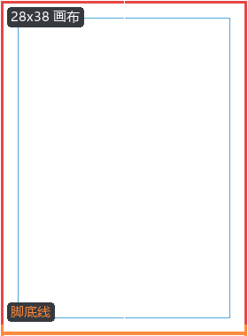

# Your Past Self — Godot 项目结构说明

> 当前可玩入口已更新为 scenes/levels/complete_room.tscn。压力板、双板锁存开门、出口结算、尖刺已实现；`R` 为「回到本关初始状态」（清空虚影 + 玩家回出生点 + 机关复位，不重载场景），整关重来走通关面板的 Replay。解法与搭建说明见 [完整房间使用说明](docs/完整房间使用说明.md)。下文有关第一关未完成的说明描述历史 level_01 场景。


第一关已从原版 `YourPastSelf.exe` 搬进 Godot 4.7。本项目按「场景化」组织：
**每个游戏元素都是独立 `.tscn`，外观由贴图决定，逻辑在 `scripts/` 里，场景只挂引用。**
策划改关卡、美术换贴图，都不需要改代码。

> **程序接手请看 [`HANDOVER.md`](HANDOVER.md)** —— 当前完成度、架构决策与被否决的方案、已知坑、未完成项排序、上传仓库前的版权注意事项。

---

## 一、目录

```
assets/                 美术素材（可直接替换同名文件）
  actors/player.png, player_death_cross.png
  blocks/*.png          地面 / 墙 / 压板 / 门 / 出口 / 尖刺（九宫格源图）
  tiles/                关卡网格瓦片：placeholder_32.png + tileset_32.tres（32×32）
  echo/*.png            虚影与虚影死亡叉号
  ui/continue_*.png     暂停「继续」按钮三态
scenes/
  blocks/*.tscn         物块：NinePatchRect + 碰撞体（各一个独立场景）
  player/player.tscn    主角
  echo/echo.tscn        虚影
  levels/complete_room.tscn  可玩房间（主场景，40×22 网格）
  levels/level_01.tscn       旧版块状关卡（历史对照，别再往里加东西）
  ui/                   hud / pause_menu / key_hint / keycap
scripts/                逻辑
_reference/             反编译出的原始工程 + 素材工具（Godot 不导入）
```

---

## 二、必读：两个文件是「正式资产」

| 文件 | 谁维护 | 注意 |
|---|---|---|
| `scenes/levels/level_01.tscn` | 策划 / 关卡 | **在编辑器里直接编辑** |
| `assets/**/*.png` | 美术 | 覆盖同名文件即可换皮 |

`_reference/tools/` 下的 `make_level.py`、`make_blocks.py`、`make_player.py`、
`make_echo_assets.py` 是**当初把原版搬过来时的一次性脚本**，现在全部加了保护：

- 目标文件已存在 → **直接跳过，不覆盖**
- 只有显式加 `--force` 才会重写（**会冲掉你手动改的关卡和美术**）

所以现在跑它们不会有副作用，但也请不要再跑 `--force`。

---

## 三、美术换图规格

### 3.1 物块：画小图，自动拉伸

物块**不再是「按最终像素尺寸画」的整图**，而是**九宫格（9-slice）源图**：
美术画一张小图，游戏里按需要的尺寸拉伸，边角不变形。

| 文件 | 源图尺寸 | 九宫格 | 说明 |
|---|---|---|---|
| `blocks/solid_ground.png` | 32 × 32 | 上边 3px 固定 | 地面。顶部 3px 亮线，下面纯填充 |
| `blocks/solid_wall.png` | 32 × 32 | 上边 3px 固定 | 左墙，同上 |
| `blocks/plate_off.png` | 8 × 8 | 无（整块拉伸） | 压力板，纯色 |
| `blocks/door.png` | 8 × 8 | 无（整块拉伸） | 门，纯色 |
| `blocks/exit.png` | 16 × 16 | 四边 3px 固定 | 出口，3px 边框 + 半透明内部 |
| `blocks/spike_tile.png` | 20 × 20 | 无（平铺重复） | 尖刺，一格；拉宽会变成多个尖刺，**不会被拉长** |

**换图 = 覆盖同名 png**。只要保持「源图尺寸 + 九宫格留白规则」不变，
拉伸出来的观感就和现在一致：地面拉多高，顶边永远是 3px；出口拉多大，边框永远是 3px。

### 3.2 物块尺寸：只改一处

每个物块场景的根节点都有一个 **`block_size`**（`scripts/block.gd` 提供）。
它是唯一尺寸来源：

- 贴图节点 `Patch.size` 跟着它
- 碰撞体 `Collision.shape.size` 跟着它，`position` 自动设成 `block_size / 2`
- 脚本带 `@tool`，**在编辑器里改 `block_size`，碰撞框会立刻跟着动**

所以改尺寸的正确姿势是：

1. 打开 `scenes/blocks/solid_ground.tscn`，选中根节点，改 `block_size` → 影响**所有**地面
2. 只想改关卡里某一个块：在 `level_01.tscn` 里选中那个实例，在检查器里改它的 `block_size`（会作为实例覆盖存在关卡文件里，不影响本体）

> 不用再手算碰撞体的 `size` 和 `position`，也不用担心「美术图变了碰撞没变」。
> 同一类物块的多个实例各自持有独立碰撞资源（`resource_local_to_scene`），改一个不会串到别的。

### 3.3 主角 / 虚影 / UI

这几个仍是 1:1 像素图（`centered = false`，左上角对齐节点原点）。

| 文件 | 尺寸 | 说明 |
|---|---|---|
| `actors/player.png` | 28 × 38 | 主角白方块 |
| `actors/player_death_cross.png` | 28 × 38 | 主角死亡叉号（透明底） |
| `echo/echo_body.png` | 28 × 38 | 虚影本体（半透明 alpha 已烘在图上） |
| `echo/echo_cross.png` | 28 × 38 | 虚影死亡叉号 |
| `ui/continue_normal.png` | 92 × 92 | 暂停按钮 · 常态（暗环 + 浅色三角） |
| `ui/continue_hover.png` | 92 × 92 | 悬停（青绿 `#7be3b9`） |
| `ui/continue_pressed.png` | 92 × 92 | 按下（环更粗、圆盘更暗） |

**主角改尺寸**：只改 `player.tscn` 里 `Collision` 的 `shape.size`，
`Sprite` 和 `DeathMark`（叉号）会按 `碰撞尺寸 / design_size(28×38)` 自动缩放，贴图不用重画。
⚠️ 这个自动缩放只补偿"碰撞体变了"，**不会补偿"图画大了"**——贴图本身仍必须是 28×38。
虚影反过来：判定尺寸是 `echo.gd` 的 `body_size`（默认 28×38），贴图会被缩放到它，换图不影响谜题；
改主角尺寸时虚影可以不动，除非两人要对齐。

⚠️ 改完**必须**同步 `Collision.position = shape.size / 2`，否则贴图和碰撞错位（脚会陷进地里）。
改完按 `F1` 用 §3.5 的调试层看一眼，比对着数字算快得多。
虚影不用手动摆 `Top.position`：改 `body_size` 时 `fit_visuals()` 会把薄片宽度和位置一起算好。

### 3.4 角色可画范围（美术必看）

角色只有两块画布，而且**画布尺寸 = 碰撞框尺寸**，不存在"差不多就行"：

| | 主角 | 虚影 |
|---|---|---|
| 画布 | **必须 28 × 38**（1:1 绘制） | **任意尺寸**（自动缩放到 `body_size` 28×38） |
| 有碰撞的范围 | 整块 28×38 | 只有**头顶 28×8**（画布最上面 8px） |
| 关键线 | 画布**底边** = 脚底线 | 画布**顶边** = 可踩线 |
| 可画区域 | 整块画布 | 整块画布（但只有顶部 8px 会挡人） |

模板图（10 倍，直接拖进 Aseprite/PS 当参考图层，画完缩小 10 倍导出）：

```
_reference/art_templates/player_guide_10x.png   280×380，红框=碰撞框，青线=2px 安全区，橙线=脚底线
_reference/art_templates/echo_guide_10x.png     280×380，青色带=可踩的 28×8 薄片
```



**五条硬规则**（违反任何一条都会在游戏里露馅）：

1. **主角画布必须正好 28×38，游戏不会帮你缩回去**。贴图按原尺寸 1:1 绘制，
   画成 56×76 就是"两倍大的角色"，整个人比碰撞框大一圈（实测过，不是猜的）。
   唯一例外：把 `player.gd` 的 `design_size` 也改成对应倍数——但那等于给自己多留一个
   必须同步的数字，不推荐。**虚影不受这条限制**：它会被缩放到 `body_size`，画大画小都不改判定。
2. **透明像素照样挡路**。碰撞体是一整块矩形，不跟着 alpha 走。四周留一圈透明边，
   看起来就是"人还没碰到墙就停住了"。
3. **装饰不能超出画布**。头发、披风、武器超出 28×38 会被直接裁掉，不会溢出显示。
   真要飘逸的效果，只能画在画布内。
4. **脚底贴住底边**。留 1–2px 空白会让角色看起来悬空，因为脚底线就是画布底边。
5. **虚影的头顶要平**。玩家实际踩的是画布最上面那条线（`Top` 薄片 28×8），
   头顶轮廓尽量在顶部 8px 内收平，否则会出现"踩在空气上"的观感。

**交图前自检**（两秒）：

```bash
python _reference/tools/check_art_size.py
```

- 通过 → 全部 `OK`
- 尺寸不对 → `BAD`，并直接告诉你"会显示成 1.5 倍大小 / x、y 被拉歪"
- 新增了没登记规格的图 → `WARN`，只是提醒，不影响运行

改完图进游戏按 `F1`，看黄框有没有贴住角色、橙线有没有压在地面（§3.5）。

### 3.5 碰撞调试层（调尺寸时开着看）

玩家和虚影场景里各挂了一个 `HitboxDebug` 节点（`scripts/hitbox_debug.gd`），
**纯绘制、不参与物理**，把碰撞范围直接画在画面上：

| 画的东西 | 含义 |
|---|---|
| 玩家周围的**黄色框** | 玩家完整碰撞体（28×38），就是「能不能钻过缝」的判定范围 |
| 玩家底部的**橙色粗线** | 脚底线。这条线才是真正踩地/踩虚影的地方 |
| 虚影顶部的**青绿色细框** | 可踩薄片（28×8，单向碰撞）——**只有这块有碰撞**，侧面和下方都没有 |
| 虚影顶部的**橙色粗线** | 可踩线，和脚底线同一个颜色 |

**两条橙线重合 = 踩上了。** 调整尺寸时盯着这两条线，比看数字直观。

> **线不会挡人，框才会。** 橙线只是把 `shape` 的那条边标出来，真正发生碰撞的是碰撞体与地面重叠的瞬间——
> 视觉上刚好就是两条线压在一起。所以「线对齐了」等于「判定是对的」，但别指望线本身有推挤效果。

- **编辑器里也生效**（`@tool`）：改 `shape.size` 或 `block_size`，框立刻重画，不用运行游戏
- **运行时按 F1** 全局开关（所有实例一起）
- 想改颜色 / 临时关掉：选中 `HitboxDebug` 节点，在检查器改 `box_fill` / `box_line` / `contact_color`，或取消 `visible`
- 觉得碍事可以直接删掉这个节点，**不影响任何碰撞和手感**

### 3.6 关卡瓦片：一格 32×32，一张图 7 格

关卡地形不用九宫格物块，用瓦片图集：`assets/tiles/placeholder_32.png`（128 × 64，4 列 × 2 行）。
配套的 `assets/tiles/tileset_32.tres` 里写了 `tile_size = 32` 和每格的碰撞。

| 位置 | 名字 | 画什么 | 有碰撞 |
|---|---|---|---|
| (0,0) | solid_top | 地表：顶部 3px 亮线 + 填充 | ✅ 整格 |
| (1,0) | solid_fill | 地下内层（无亮线） | ✅ 整格 |
| (2,0) | solid_wall | 竖墙（右侧加深） | ✅ 整格 |
| (3,0) | one_way | 单向板，只画上面 8px | ✅ 只有上面 8px |
| (0,1) | air | 空瓦片：只画极淡格线 + 四角小点 | ❌ |
| (1,1) | decor | 装饰板，半透明 | ❌ |
| (2,1) | spawn_mark | 出生点十字标记 | ❌ |

三条硬规矩：

1. **一格正好 32×32**，整张图的宽高必须是 32 的整数倍
2. **碰撞不在图上，在 `tileset_32.tres` 里**——所以换图不会改玩法。想让某格变成实心/空心，改 tres 的
   `physics_layer_0/polygon_0`，别指望「画得实一点」就有碰撞
3. **瓦片不要留透明边**。九宫格物块允许留边，瓦片不允许：留了边，相邻两格之间就会露缝

想改配色/质感：直接覆盖这个 png。想重新生成一版占位图：`python _reference/tools/make_grid_tiles.py --force`
——⚠️ 这会**覆盖手绘的图集**，只在还没人画之前跑。

---

## 四、改关卡

可玩房间是 `scenes/levels/complete_room.tscn`（`level_01.tscn` 是旧版块状关卡，留着对照）。

### 4.1 先记一个数：32

| 项 | 值 |
|---|---|
| 一格 | **32 × 32 像素** |
| 整张图 | **40 列 × 22 行 = 1280 × 704**，正好一屏，不用滚屏 |
| 地面顶边 | **y = 576**（第 18 行的上边线），脚踩这条线 |
| 换算 | 像素 ÷ 32 = 格子；格子 × 32 = 像素。256 就是第 8 格 |

房间里有三层瓦片，从下往上：

| 层 | 作用 | 有碰撞 |
|---|---|---|
| `Background` | 一整块底色，垫在最下面 | — |
| `Map_Placeholder` | **880 个空瓦片铺满整张地图**，带极淡的格线 | ❌ |
| `World` | 地表 / 地下 / 左右两侧墙 | ✅ 玩家和虚影撞的是这层 |
| `Decor` | 装饰，空着等你画 | ❌ |

**空瓦片别删。** 地图边界不是靠底色猜的，就是这 880 个格子。删一片，那一块就真的「没有地图」了。

刷地形的规矩：

- 能站的表面用 `solid_top`（顶边有亮线），它下面用 `solid_fill` 填满
- 左右边界用 `solid_wall`
- 想加一块悬空平台用 `one_way`（能从下往上穿过去）
- 画完看一眼：**地表必须正好在第 18 行**，不然玩家出生会卡在地里或悬空

机关（压板/门/出口/尖刺）放的时候要对齐格线：**左边是 32 的倍数、底边压在 576、宽是 32 的倍数**。
现在的参数：

| 机关 | 像素矩形 | 占几格 |
|---|---|---|
| 尖刺 | (32, 544) 64×32 | 1–2 列，第 17 行 |
| 压板 A / B | (352 / 640, 564) 64×12 | 11 / 20 列，第 17 行 |
| 门 | (832, 416) 64×160 | 26–27 列，13–17 行 |
| 出口 | (1120, 448) 64×128 | 35–36 列，14–17 行 |

以上任意一条不对，跑 `--headless` 测试会直接报错（`test_grid_room.gd`），不会等到美术画完才发现。

### 4.2 拖拽规则

打开 `scenes/levels/complete_room.tscn`，直接拖：

- **加物块**：从文件系统把 `scenes/blocks/xxx.tscn` 拖进场景（是实例，不是复制节点）
- **改物块大小**：选中实例，在检查器改根节点的 **`block_size`**（贴图与碰撞一起变）
- **改重生点**：挪 `RespawnPoint` 这个 Marker2D
- **改相机范围**：`Camera2D` 的 limit_left / limit_right
- **画面尺寸**：`project.godot` 的 viewport_width / height，以及 `Background`、`Grid` 的覆盖范围

⚠️ 物块是**实例**：在关卡里改某个物块的外观只影响那一个；打开 `solid_ground.tscn`
本体去改，才会影响所有关卡里的地面。这是 Godot 的标准行为，也是这套结构的好处。

---

## 五、改底部操作提示（HUD）

HUD 是 autoload（`project.godot` → `[autoload]` → `Hud`），**所有关卡共用**，不用每关摆。

| 想改什么 | 打开哪个场景 | 操作 |
|---|---|---|
| 加/删一条操作提示 | `scenes/ui/hud.tscn` → `Root/Hints` | 复制一个 `KeyHint` 实例，改检查器里的 `keys` 和 `desc` |
| 键帽文字 | 同上 | `keys` 是字符串数组，`["A","D"]` 就是两个键帽 |
| 说明文字 | 同上 | `desc` |
| 键帽样式（圆角/颜色/九宫格图） | `scenes/ui/keycap.tscn` | `PanelContainer` 的 `theme_override_styles/panel` |
| 说明文字样式 | `scenes/ui/key_hint.tscn` | `Desc` 节点（颜色、字号） |
| 整条底栏背景 | `scenes/ui/hud.tscn` → `BarBg` | `theme_override_styles/panel`，可换九宫格贴图 |
| 右侧「回声 n / 5」 | `hud.tscn` → `Count` | 文字由 `hud.gd` 自动刷新，样式随便改 |

`scripts/hud.gd` 只做两件事：刷新回声计数、显示一行闪现提示（虚影重置/满员替换）。
**加一条操作提示不需要碰它。**

---

## 六、虚影（回声）换皮

`scenes/echo/echo.tscn` 里两个 Sprite2D：

- `Body` — 本体，死亡淡出只作用在它身上（`modulate.a` 从 1 → 0.18）
- `Cross` — 死亡叉号，默认隐藏，只在「死亡 1.3 秒」期间显示，**不跟着淡**

换皮 = 替换 `assets/echo/echo_body.png` / `echo_cross.png`，或改这两个节点的 `texture`。
玩家踩它用的是头顶一条 28×8 的单向薄片（`Top` 节点），和外观无关，换图不用动它。
（虚影自己撞墙、撞门的判定不在这条薄片上，见下一节。）

### 6.1 虚影的体积落在哪（改机制前必看）

虚影是「重放坐标」而不是「跑物理」，位置由轨迹喂进去；但它**每帧会做一次形状扫描**，所以对世界是有实体的：

| 对象 | 认不认虚影的体积 | 依据 |
|---|---|---|
| **压力板** | ✅ 认，按 `body_size`（默认 **28×38**）算 | `actor_bounds.gd` 取 `echo.body_rect()`，**看脚底**是否落在板面高度带内——不读贴图 |
| **墙 / 关着的门** | ✅ 挡住，撞上停在墙面 | `echo.gd` 的 `_clip_motion()`：每帧 `cast_motion` 只扫 layer 1 |
| 出口 | ❌ 只认玩家 | 只遍历 `player` 组（虚影站在出口上不会通关） |
| 尖刺 | ❌ 只杀玩家 | 同上（虚影不会被扎死） |
| 玩家踩虚影头顶 | ✅ 只有 28×8 薄片 | `echo.tscn` 的 `Top`，单向碰撞 |

三条容易踩的：

1. **压力板的"体积"来自 `body_size`，不是贴图**——美术换 56×76 或留透明边，都只会被缩放到 28×38，判定不变。想改体积改 `body_size`，别改图片（`test_echo_contract.gd` 钉住这条）。
2. **挡住是"截短位移"，不是"改碰撞层"**：给 echo 设 `collision_mask` 会让引擎自己推它，和喂进去的坐标打架；现在的做法是 `cast_motion` 算出安全比例，只让虚影走到接触点。改这段别看错地方。
3. **被挡住的虚影会停在墙边，但时间照走**（帧号继续前进）。所以「录的时候门开着、重放时门关着」→ 虚影卡在门外，**不会**到板上去。这是预期行为，关卡设计要避开（别让关键路线依赖一扇之后会关的门）。

**虚影只有一个激活状态**：生成时（玩家还在死亡淡出）不显示、无碰撞、不推进、机关不认；
玩家复活时 `reset()` 才三件事同时生效。所以不会出现「看不见的虚影把板压住 / 把人托住」。
让虚影出现只调 `reset()`，不要手改 `visible`。

回归测试：`test_echo_environment.gd`（压板/释放/悬空不触发/门挡得住/开门能过/尸体淡出 1.3 秒内仍压得住板）
+ `test_echo_contract.gd`（换图不改判定 / 未激活不生效 / 复活才登场）。

---

## 七、场景 → 脚本 对照

| 场景 | 脚本 | 职责 |
|---|---|---|
| `levels/level_01.tscn` | — | 关卡布局、重生点、相机 |
| `blocks/*.tscn` | `scripts/block.gd` | 物块尺寸同步：`block_size` → 贴图 + 碰撞 |
| `player/player.tscn` | `scripts/player.gd` | 移动、跳跃、死亡/重生 |
| （玩家/虚影里的 HitboxDebug） | `scripts/hitbox_debug.gd` | 碰撞框可视化，纯绘制，F1 开关，**不参与物理** |
| `echo/echo.tscn` | `scripts/echo.gd` | 轨迹重放、单向碰撞、死亡延时 |
| （关卡里的 EchoManager） | `scripts/echo_manager.gd` | 录制、生成虚影、上限、`R` 重置（人回起点 → 机关复位 → 清虚影） |
| （关卡里的 Camera2D） | `scripts/camera_follow.gd` | 跟随 + 边界夹取 |
| `ui/hud.tscn` | `scripts/hud.gd` | 底部操作栏、回声计数、闪现提示 |
| `ui/key_hint.tscn` | `scripts/key_hint.gd` | 一组「键帽 + 说明」 |
| `ui/keycap.tscn` | `scripts/keycap.gd` | 单个键帽 |
| `ui/pause_menu.tscn` | `scripts/pause_menu.gd` | ESC 暂停 / 继续 |
| （暂停里的按钮） | — | `TextureButton`，外观全在 `assets/ui/continue_*.png`，无脚本 |

---

## 八、可调数值在哪

| 数值 | 位置 | 当前值 |
|---|---|---|
| 移动速度 / 加速度 / 摩擦 | `player.gd` 的 `@export` | 210 / 1800 / 2200 |
| 跳跃初速 / 重力 / 短跳系数 | `player.gd` 的 `@export` | -510 / 1400 / 0.65 |
| 死亡动画时长 | `player.gd` 的 `death_duration` | 1.3s |
| 虚影死亡（尸体）时长 | `echo.gd` 的 `fade_duration` | 1.3s |
| 虚影上限 | `echo_manager.gd` 的 `MAX_ECHOES` | 5 |
| 掉出地图判死高度 | `player.gd` 的 `kill_y` | 750 |

主角和虚影的数值都是 `@export`，可以在编辑器检查器里直接改，不用动代码。

---

## 九、`_reference/` 是什么

反编译原始游戏得到的对照资料 + 一次性工具，带 `.gdignore`，**Godot 不会导入、跑游戏不需要它**。

- `source_from_game/` — 反编译出的原版工程（`world.gd` / `main.gd` / `levels.gd`），调数值时可对照
- `tools/` — 素材生成脚本（`make_blocks` / `make_player` / `make_echo_assets` / `make_ui_assets` / `make_level`，均已冻结）
  + 自动化测试脚本（`test_*.gd`，headless 运行）
  + **`check_art_size.py`**（交图后校验尺寸）、`make_art_templates.py`（重新生成可画范围模板）
- `art_templates/` — 角色可画范围模板图（10 倍），见 §3.4
- `preview_*.png` — 各阶段验证截图

---

## 十、还没做

- 压力板 → 开门逻辑（门现在是实体墙，第一关**过不去**）
- 出口结算
- 尖刺的伤害判定
- 箱子、移动平台、第 2–8 关
