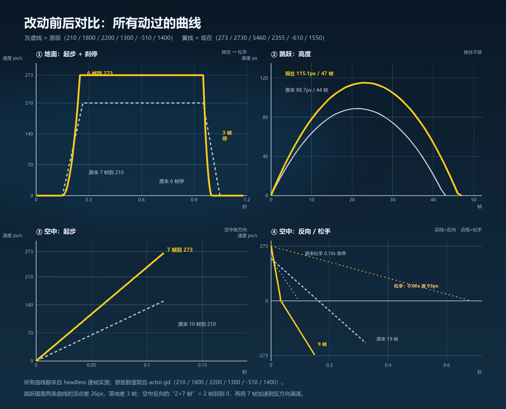
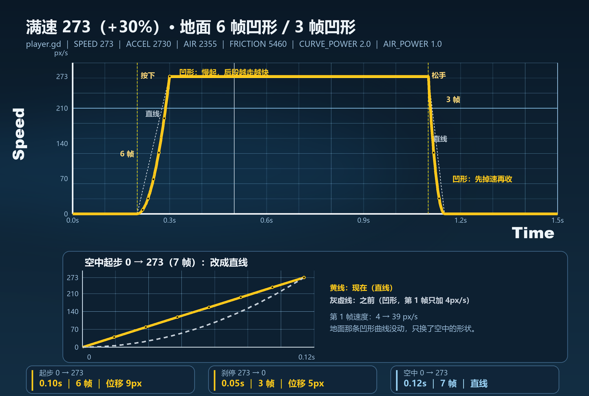
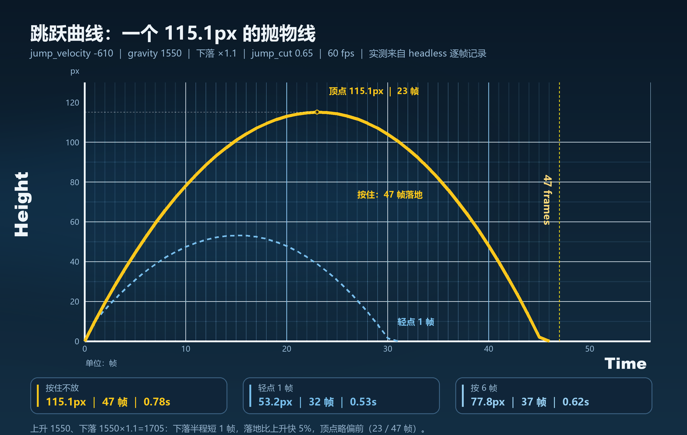

# 手感调参记录（2026-11-19）

> 这一轮只动了 `scripts/player.gd` 的水平移动与跳跃参数，外加 4 个验证脚本和 4 个画图脚本。
> 关卡、虚影、UI、美术都没动。

## 0. 一图看完全部改动



灰虚线是原版（210 / 1800 / 2200 / 1300 / -510 / 1400），黄线是现在。四格分别是地面起停、跳跃高度、空中起步、空中反向与松手。

## 1. 现在的一套数值

`scripts/player.gd` L14–L49 的导出变量：

| 变量 | 值 | 含义 |
| --- | --- | --- |
| `max_speed` | **273** | 满速，原 210 × 1.3 |
| `accel` | **2730** | 地面起步平均加速度 → 6 帧（0.10s）到满速 |
| `air_accel` | **2355** | 空中起步 → 7 帧（0.116s） |
| `friction` | **5460** | 地面刹停 → 3 帧（0.05s） |
| `air_friction` | **400** | 空中松手阻力 → 0.68s / 93px 滑停 |
| `air_turn_stop` | **8200** | 空中反向急停 → 满速约 2 帧归零 |
| `curve_power` | **2.0** | 地面曲线凹度：1 = 直线，2 = 凹形 |
| `air_curve_power` | **1.0** | 空中曲线：直线，按下立刻有速度 |
| `gravity` | **1550** | 基础重力（原 1400） |
| `jump_velocity` | **-680** | 起跳速度（原 -510，本轮从 -610 上调；满跳 143.6px = 4.49 格） |
| `fall_gravity_mult` | **1.1** | 下落重力倍率（上升 100%，下落 110%） |
| `jump_cut` | **0.45** | 松开跳跃键的上升速度系数（本轮从 0.65 下调，见 §3） |
| `coyote_time` / `jump_buffer` | **0.12** / 0.12 | 土狼时间本轮 0.10 → 0.12（实测 5 帧 → 6 帧） |

## 2. 水平移动



曲线由 `_approach_speed()` 生成：按帧推进一段“起点 → 终点”的插值，`_shape(u, rising, p)` 决定形状。
`p = 2` 时加速是 `u²`（慢起、后段越快），刹车是 `1-(1-u)²`（先掉速再收），两条都压在两点连线的下方。

实际逐帧（60fps，headless 实测）：

```
起步 0 → 273：7.6  30.3  68.2  121.3  189.6  273        （6 帧）
刹停 273 → 0：121.3  30.3  0                            （3 帧）
空中 0 → 273：39  78  117  156  195  234  273           （7 帧，直线）
空中反向   ：273 → 136 → 0 → -39 → … → -273            （2 + 7 = 9 帧）
空中松手   ：每帧只掉 6.7px/s，0.68s 滑 93px 后停
```

三个刻意的设计：

1. **地面起步是凹的**（参考图那种慢起后快），但空中用直线——空中要的是立刻响应，不是重量。
2. **松手有惯性，反向没有**：松手走 `air_friction` 慢慢飘；按反方向则用 `air_turn_stop` 在 2 帧内归零，再按反方向重新加速。
3. **地面刹停比起步陡一倍**（3 帧 vs 6 帧），落地干脆。

## 3. 跳跃



| | 数值 |
| --- | --- |
| 按住不放 | 143.6px（4.49 格），52 帧（0.87s） |
| 顶点 | 第 27 帧 |
| 轻点 1 帧 | 36.5px（1.14 格），26 帧 |
| 按 3 帧（自然轻点） | 53.0px（1.66 格），30 帧 |
| 按 6 帧 | 75.1px（2.35 格），35 帧 |
| 落地速度 | 约 700 px/s（比起跳的 680 快 3%） |

`jump_cut` 为什么是 0.45：原来 0.65 配合 -610，按 3 帧正好 63.8px，离 2 格（64px）只差
**0.2px**。人手一次自然轻点约 50ms（3 帧），于是同一个操作有时过有时不过——这就是「卡手」。
改成 0.45 后同样按 3 帧只有 53px，要到 5 帧（83ms）才上 2 格，和自然轻点拉开 33ms。
详细逐帧数据见 `docs/跳跃卡手分析.md`。

重力恒定、只在下落时乘 1.1，所以曲线不对称：上升慢、下落快，顶点略偏前。若想要完全对称，把 `fall_gravity_mult` 设回 1.0。

## 4. 这轮新增的文件

| 文件 | 作用 |
| --- | --- |
| `_reference/tools/test_speed_curve.gd` | 逐帧打印地面起步/刹停/反向速度 |
| `_reference/tools/test_air_turn.gd` | 空中满速反向的逐帧速度 |
| `_reference/tools/test_jump_curve.gd` | 各档按住帧数的跳高与滞空，并导出完整轨迹 |
| `_reference/tools/test_air_drag.gd` | 空中松手后的滑行帧数与距离 |
| `_reference/tools/charts/plot_speed_curve.py` | 画“原版 vs 调参档位”两条移动曲线 |
| `_reference/tools/charts/plot_new_curve.py` | 画当前移动曲线（含空中那一小图） |
| `_reference/tools/charts/plot_jump_curve.py` | 画跳跃抛物线 |
| `_reference/tools/charts/plot_compare.py` | 画改动前后四格对比图 |
| `docs/手感调参.md` | 本文 |

画图脚本只依赖 Pillow，字体写死 `C:\Windows\Fonts`（Windows 专用），数据是脚本里写死的 headless 实测值；改了参数要重跑测试再把数字填回去。

## 5. 回归怎么跑

```bash
# 逐帧速度
godot --headless --path . -s _reference/tools/test_speed_curve.gd
godot --headless --path . -s _reference/tools/test_air_turn.gd
godot --headless --path . -s _reference/tools/test_air_drag.gd

# 跳高 / 滞空 / 轨迹
godot --headless --path . -s _reference/tools/test_jump_curve.gd
```

对照值：

- 地面起步 6 帧到 273，刹停 3 帧到 0；
- 空中反向 9 帧（2 帧归零 + 7 帧反向）；
- 松手滑行约 15～32 帧 / 90px 上下，取决于起跳时的高度；
- 满速跳 143.6px（4.49 格）、52 帧；轻点 1 帧 36.5px（1.14 格）、26 帧。

## 6. 调参速查

- **起步/刹停帧数**：`accel = 273 × 60 ÷ 起步帧数`，`friction = 273 × 60 ÷ 刹停帧数`。
- **空中更跟手**：`air_accel` 上调（2730 ≈ 6 帧）；**更飘**：`air_friction` 下调（250 ≈ 0.9s / 149px）。
- **反向更干脆**：`air_turn_stop` 上调（16400 ≈ 1 帧归零）。
- **跳更高/更久**：`jump_velocity` 与 `gravity` 要一起动，单改一个只会改高度不改时间。
- **下落更砸**：`fall_gravity_mult` 1.1 → 1.25。

## 7. 已知影响

- 满速从 210 提到 273，满速跳跃的水平距离约 236.6px / 7.39 格（原来 154px），关卡沟距按旧速度摆的需复核。
- 跳高从 89px → 115px → **143.6px**（4.49 格），头顶低于 143.6px 的通道会撞头。
- **高度上限是 -718**：示例房间 `complete_room` 的门高 160px，-680 时脚底只到 432.4（门顶 416），
  实测 -712 仍被挡住、-720 直接跳过门（跑到 x=1216）。再往上调会破关。
- 虚影是逐帧回放，不受这些参数影响；但同一关里“人”和“虚影”的手感会不一致。
- `HANDOVER.md` §11.5 原来写“数值全部照抄原版”，已不再成立，改成指向本文。
